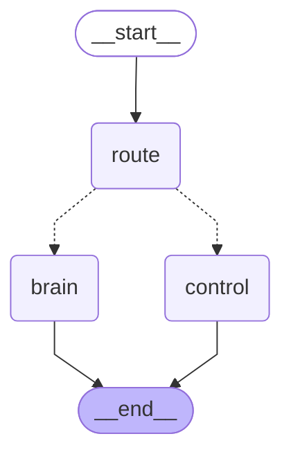
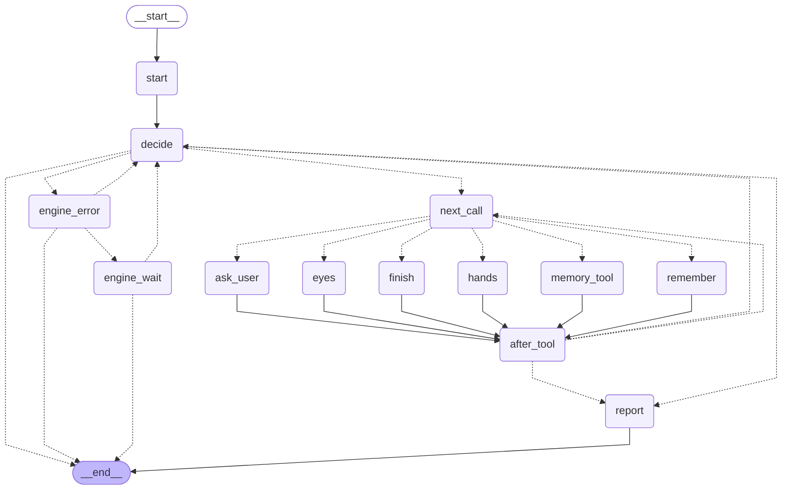
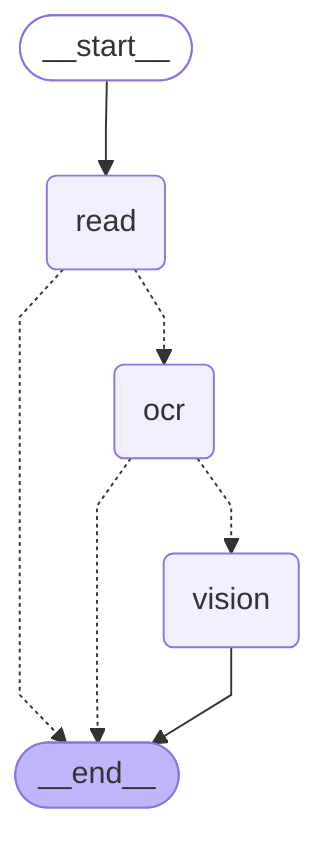
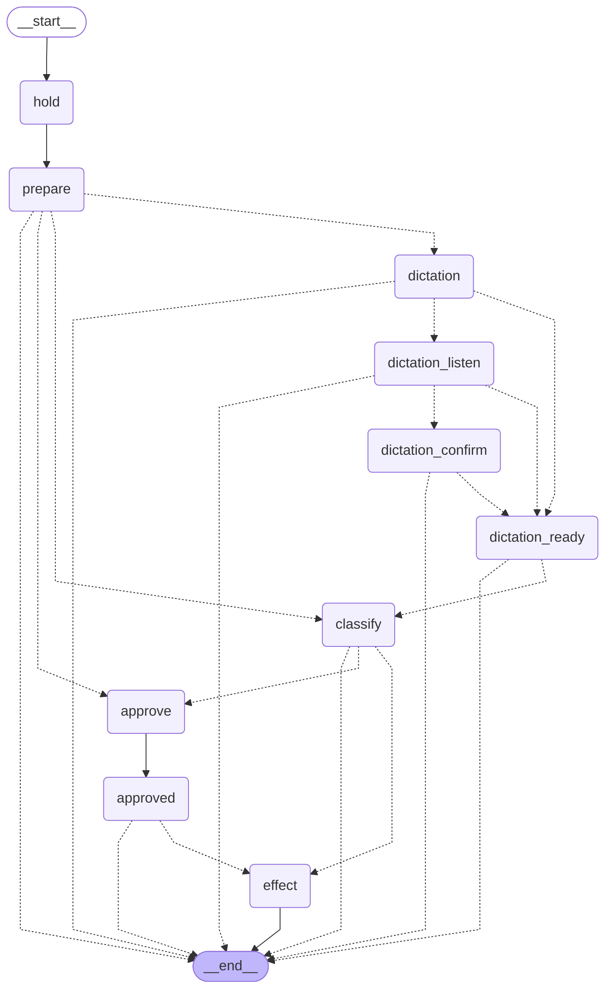
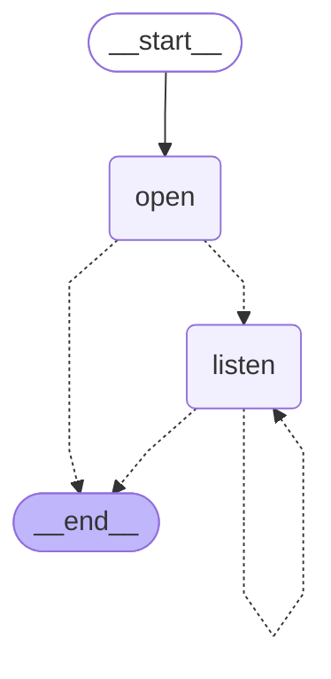

# OFA graphs

Generated by `scripts/draw_graphs.py` from the compiled LangGraph graphs; do not edit by hand.
How they fit together and why: [ARCHITECTURE.md](ARCHITECTURE.md). Code: `ofa/graphs/`.

- **turn** receives one finished sentence. `pause` / `continue` are answered at once; everything else goes to the brain.
- **brain** loops engine → tools until the engine calls `finish`, 25 steps pass, or the same call returns the same
  result three times. `report` says "Completed" only when OFA's own evidence shows the effect.
- **eyes** answers "what is on screen / where is X": accessibility first, OCR for text-poor windows, then the
  vision provider chosen in Settings → Eyes (local, separate model, or the reasoning model). Every element gets a
  mark (m1, m2, …) the hands can click.
- **hands** is the policy gate. Tier 0/1 actions run straight away; Tier 2 needs a spoken yes through **approval**.
  An approved action runs in its own `effect` node, so resuming a saved task never repeats it.
- **approval** speaks the exact action, listens, re-asks once, and accepts only microphone speech that is not
  OFA's own voice.

Nodes that ask you something pause with `interrupt()`; `ofa/graphs/runner.py` speaks the question and resumes
the graph with your answer. A finished task is deleted from the checkpoint store (`%LOCALAPPDATA%/OFA/graphs.db`);
a stopped one stays so "continue the last task" can pick it up.

## turn

## brain

## eyes

## hands

## approval

