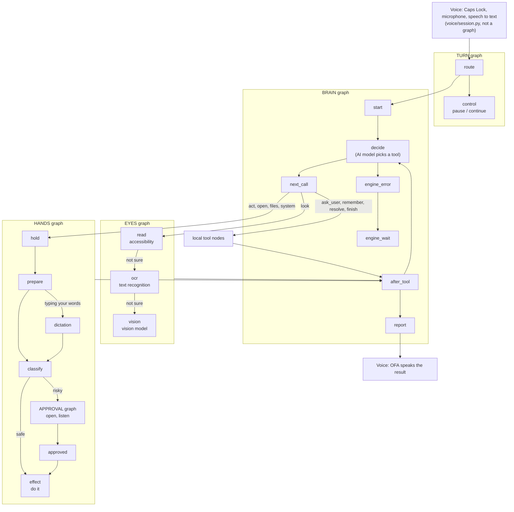
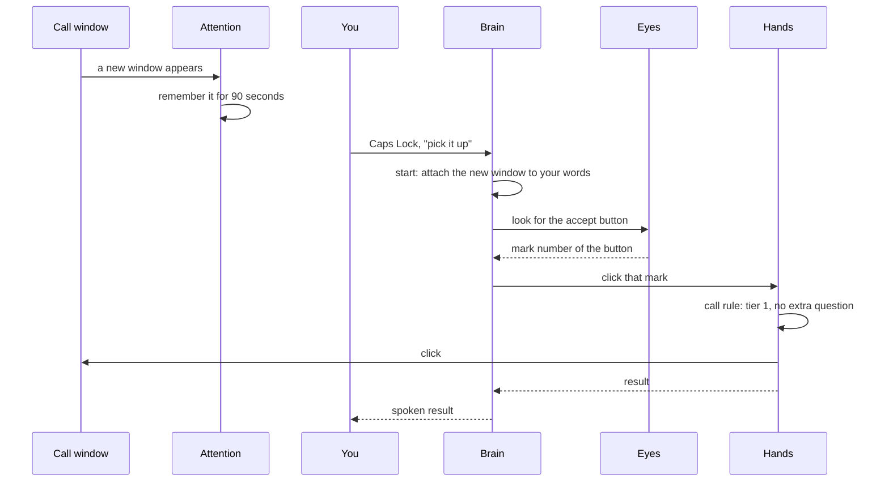
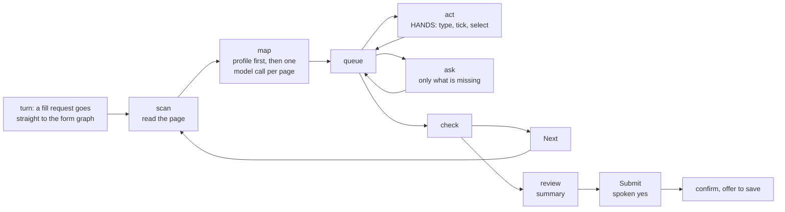

# How OFA works

Simplified view. Full diagrams generated from the code: [GRAPHS.md](GRAPHS.md). Code: `ofa/graphs/`.

## 1. The graphs

## 2. Nodes

| Graph | Node | Job |
|---|---|---|
| Turn | `route` | Sends pause/continue to `control`, everything else to the brain |
| Brain | `start` | Builds the prompt; adds the new pop-up if you said "it", "call", "pick up" |
| Brain | `decide` | Asks the AI model for the next tool call |
| Brain | `next_call` | Routes the tool call |
| Brain | `after_tool` | Gives the result back; stops loops |
| Brain | `report` | Writes the spoken result |
| Brain | `engine_error`, `engine_wait` | Retry, or ask you whether to wait |
| Eyes | `read` | Reads controls of visible windows and numbers them (m1, m2, …) |
| Eyes | `ocr` | Adds text recognition for windows with little readable text |
| Eyes | `vision` | Sends a masked, numbered screenshot to the vision model |
| Hands | `hold` | Waits while paused |
| Hands | `prepare` | Turns the tool call into one exact action |
| Hands | `dictation*` | Gets and checks your exact words |
| Hands | `classify` | Decides the risk level (tier 0, 1 or 2) |
| Hands | `approve`, `approved` | Spoken yes for tier 2, used once |
| Hands | `effect` | Performs the action and logs it |

## 3. State (the data passed between nodes)

Defined in `ofa/graphs/state.py` (`EyesState` is in `eyes.py`).

| State | Main fields |
|---|---|
| `TurnState` | `text`, `confidence`, `result` |
| `BrainState` | `messages`, `calls`, `actions`, `step`, `finished`, `plan_approved`, `result` |
| `EyesState` | `call`, `look` (question, scope), `tool_out` |
| `HandsState` | `call`, `action`, `tier`, `verdict`, `tool_out` |
| `ApprovalFlow` | `action`, `approval` (prompts, deadline), `verdict`, `approval_id` |
| `FormState` (in `form.py`) | `page`, `queue`, `asks`, `answered`, `skipped`, `speed` |

- A question to you pauses the graph (`interrupt()`); `runner.py` speaks it and resumes with your answer.
- A finished task is deleted from `graphs.db`. The last unfinished one is kept.

## 4. Example: "pick it up"

The call rule skips the extra question only when **all** of these are true:

1. The click targets the window that just appeared.
2. The button says accept, answer, pick up, join or receive.
3. Your own words asked to pick up or answer.
4. **Settings → Hands → Answer calls** is on.

Code: `eyes/attention.py`, `graphs/brain.py` (`popup_note`), `graphs/eyes.py`, `graphs/hands.py` (`on_popup`),
`policy/tiers.py` (`ANSWER_LABEL`, `ANSWER_WORDS`).

## 5. Example: "I'm running out of time, fill it quickly"

| Who answers | Questions |
|---|---|
| Your profile, no model | Name, email, phone, location, LinkedIn, GitHub, university, degree |
| Model, from your profile only | Everything else it has facts for; long answers are composed |
| You, by voice | Missing facts, personal decisions (relocate, salary, availability …), declarations |
| Private items (asked in detail) or you | Passwords, ID and bank numbers |

Guards in code: an answer with a number that is not in your profile, or a bare "Nil" / "No", is asked instead.
The first question is spoken while the known answers are still being typed.

Code: `graphs/form.py`, `forms.py`, `eyes/form.py`, `corpus/open.py`.

**Info corpus** (E-Brain page): *Use without consent* = Markdown in `%LOCALAPPDATA%/OFA/corpus/open/`, readable by
OFA. *Private* = the encrypted vault; values never reach a model and every use is asked aloud.

## 6. The three Eyes modes

All modes start the same way: Windows accessibility, then Windows on-device text recognition. They differ only in
what happens when those are not sure.

| Mode | Last step | Model | Screenshot leaves the laptop |
|---|---|---|---|
| Local only | Fuzzy text matching on the laptop | None | No |
| Separate eyes model | Masked, numbered screenshot to its own vision model | Groq `qwen/qwen3.8-27b` (changeable), Groq key | Yes, when needed |
| Same as reasoning model | Same screenshot to the reasoning model | The reasoning model, only if it can see images; otherwise works like Local | Only if it can see |

In **every** mode, the text of the numbered elements is sent to the reasoning model so it can choose what to do.
